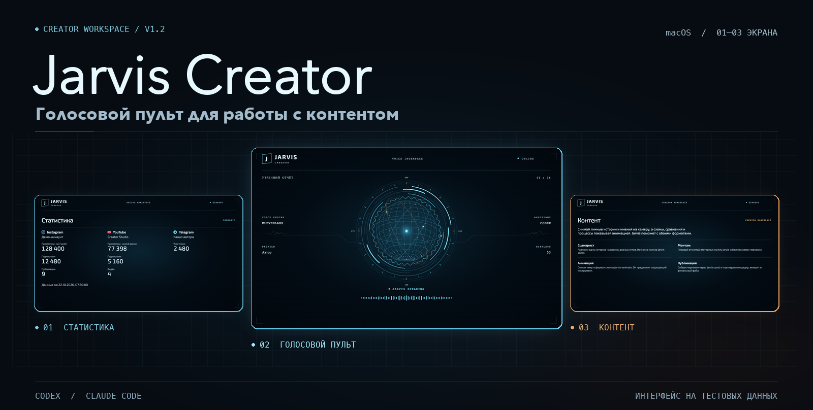

# Jarvis Creator

**Голосовой пульт для авторов контента на Mac и навыки для Codex и Claude Code.**

Запусти утренний отчёт двумя хлопками. Jarvis озвучит доступные показатели и откроет панели статистики и контента. Дальше можно задать вопрос голосом или открыть проект в агенте и перейти к сценарию, монтажу или черновику публикации.

[Скачать Jarvis](https://github.com/C0mrade530/jarvis-creator/releases/latest) · [Быстрый старт](#быстрый-старт) · [Демо](#демо) · [Полное руководство](docs/guide.md) · `1.2.0`



## Быстрый старт

1. **Распакуй проект.** Скачай архив с исходниками из [релиза](https://github.com/C0mrade530/jarvis-creator/releases/latest) или выбери **Code → Download ZIP**. Для команд нужен Python 3.10 или новее.
2. **Запусти Jarvis на Mac.** Нужны macOS 14 или новее и Xcode Command Line Tools. Открой терминал в папке с файлом `jarvis` и выполни команды. При первом запуске приложение соберётся из исходников.

   ```sh
   ./jarvis doctor
   ./jarvis start
   ```

   Введи имя, выбери системный голос и нажми `Space`, чтобы запустить отчёт. Для запуска двумя хлопками включи «Хлопки» и разреши доступ к микрофону.
3. **Открой ту же папку в Codex или Claude Code.** Отправь агенту сообщение из [START.md](START.md). Он подхватит настройку профиля и предложит следующие шаги. Соцсети и дополнительные голоса можно подключить позже. Навыки также доступны отдельно от приложения Mac.

## Демо


Обложка показывает настоящий интерфейс с тестовыми данными. На одном экране статистика и контент открываются из пульта. На двух они делят внешнюю панель. На трёх каждый раздел получает свой экран.

## Что умеет Jarvis

| Задача | Как это работает |
| --- | --- |
| **Утренний отчёт** | Запускается с пульта, клавишей `Space` или двумя хлопками. Jarvis озвучивает сохранённый отчёт и открывает панели. |
| **Статистика соцсетей** | Composio читает показатели подключённых аккаунтов. На простой вопрос Jarvis отвечает из свежего кэша и называет время обновления. |
| **Разговор с Jarvis** | Вопрос можно ввести или произнести. В обычном режиме отвечает выбранный Codex или Claude Code. GPT-Live 1 доступен отдельно и поддерживает разговор, в котором Jarvis слушает во время ответа. |
| **Работа над роликом** | Навыки ведут от истории и сценария к монтажу или анимации. Агент проверяет исходники и доступные инструменты перед сборкой. |
| **Публикация** | Агент готовит материал и показывает, куда и что отправится. Публикация требует подключения нужного аккаунта и согласования. Для Threads есть отдельный процесс с очередью и расписанием. |

## Подключения по желанию

- **Реальные цифры.** Подключи нужные площадки через Composio и обнови статистику в пульте. Instagram может вернуть просмотры за семь завершившихся дней по UTC, YouTube — просмотры канала за всё время, Telegram — число участников. Доступ зависит от аккаунта и прав. [Настройка статистики](docs/guide.md#подключение-соцсетей)
- **Голос.** Для отчёта можно выбрать системный голос Mac, подключить свой ElevenLabs или настроить локальный VoiceStudio на совместимом Mac. [Настройка голоса](docs/guide.md#голос-elevenlabs)
- **GPT-Live 1.** Нужен собственный ключ OpenAI API. Во время активного разговора звук микрофона передаётся в OpenAI, а сессия расходует баланс API. Сложный вопрос Jarvis может передать выбранному агенту. [Настройка GPT-Live 1](docs/guide.md#gpt-live-1)
- **Threads.** Для расписания нужны отдельная настройка, свой ключ Upload-Post, подключённый аккаунт и запущенный обработчик очереди. [Настройка Threads](docs/guide.md#автопостинг-в-threads)

Ключи ElevenLabs и OpenAI вводятся в настройках Jarvis и сохраняются в Связке ключей macOS.

[Полное руководство](docs/guide.md) включает горячие клавиши, требования к площадкам, команды для работы с контентом и сборку из исходников.
